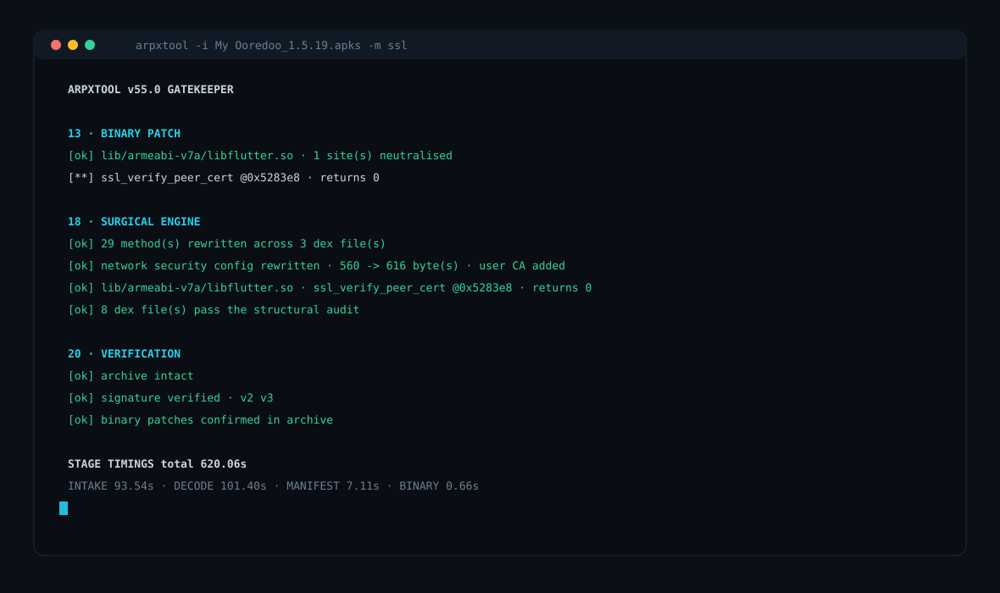
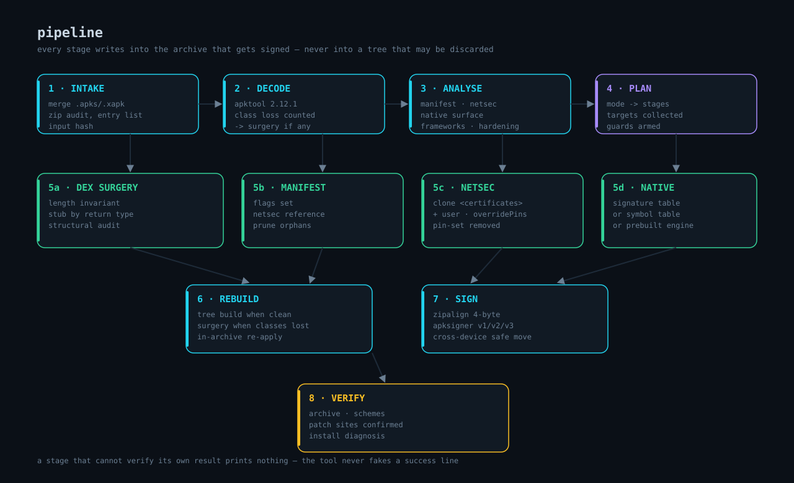
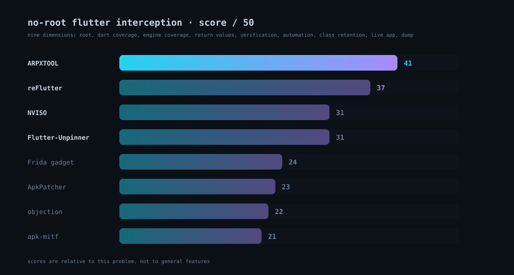

# ARPXTOOL

<p align="center">
  
</p>

<p align="center">
  <b>Android reverse-engineering toolkit for Termux — decompile, inspect, patch, repack and sign APK files without root and without Frida.</b>
</p>

<p align="center">
  <code>v55.0 · GATEKEEPER</code> · <code>python 3.12</code> · <code>termux</code> · <code>no root</code>
</p>

---

## Why it exists

Intercepting a modern Android app is not one problem, it is four: the platform
trust store, the app's own network-security-config, the Java pinning layer, and
— for Flutter — a BoringSSL compiled inside `libflutter.so` that ignores all
three. Most tools solve one of them and claim the rest.

ARPXTOOL solves all four in the APK itself, and then **re-opens the signed
output to prove every patch is actually there**. It never prints a success
marker for something it did not verify.

<p align="center">
  
</p>

## What it does

| Capability | Detail |
|---|---|
| **Static analysis** | manifest, permissions, exported components, native surface, framework inventory, hardening and packer markers, behavioural signals |
| **DEX surgery** | patches methods in the original DEX files under a strict length invariant, so classes apktool fails to disassemble are never lost |
| **Trust layer** | rewrites the app's own network-security-config in place: `user` anchor added, `overridePins="true"`, `pin-set` and `domain-config` removed, cleartext forced |
| **Java pinning** | neutralises trust managers, hostname verifiers, OkHttp `CertificatePinner`, conscrypt and chain cleaners — chosen by signature shape, with a stub that matches each method's real return type |
| **Flutter engine** | signature-based `libflutter.so` patching validated on 36 real engine builds, with the correct success value per BoringSSL function |
| **Unknown engines** | reads the engine build id, fetches the matching prebuilt patched engine automatically, ABI-checked, cached |
| **Integrity** | every DEX is structurally validated before signing; a build that would not launch is refused instead of shipped |
| **Verification** | archive, signature schemes, patch sites, install diagnosis — with `unavailable` instead of fake values |

## Install

```bash
pkg update -y && pkg install -y python git openjdk-17
git clone https://github.com/ahmaeddev/arpxtool.git
cd arpxtool
bash install.sh
```

## Usage

```bash
arpxtool -i app.apk                          # full analysis + patch + sign
arpxtool -i app.apk -m ssl                   # TLS neutralisation only
arpxtool -i app.apk -m signature --remove-license
arpxtool -i app.apk -m fast                  # manifest + netsec, never smali
arpxtool -i app.apk -m surgery               # no java, no apktool, no aapt2
arpxtool -i app.apk -m native --flutter-engine ./libflutter_arm.so
arpxtool --self-check                        # 34 internal checks
```

Modes: `detect · fast · full · inspect · native · re · security · signature · ssl · surgery · unpack · verify`

## Results, measured

| Test | Result |
|---|---|
| Flutter engines matched (36 real builds) | **36 / 36**, exactly one site each |
| Function split | 34 `ssl_verify_peer_cert` (returns 0) · 2 chain verifier (returns 1) |
| Unit suites (`dex`, `netsec`, `flutter`) | **ALL PASS** |
| Internal checks | **34 / 34** |
| Real build on device | 620 s · 29 methods rewritten · engine patched in-archive · **traffic intercepted** |

Full numbers, the regression log of nine real defects, and what is still not
covered: **[docs/TESTING.md](docs/TESTING.md)**

## Pipeline

<p align="center">
  
</p>

Every stage writes into the archive that gets signed — never into a tree that
may be discarded. Deep dive, stage by stage, with the invariants each one
protects: **[docs/ARCHITECTURE.md](docs/ARCHITECTURE.md)**

## Comparison with seven other tools

<p align="center">
  
</p>


NVISO · reFlutter · Flutter-Unpinner · ApkPatcher · objection · apk-mitf · Frida
— scored across nine dimensions, with where each one beats this tool:
**[docs/COMPARISON.md](docs/COMPARISON.md)**

Short version: **41/50** for ARPXTOOL on no-root Flutter interception, ahead of
reFlutter (37) and NVISO (31). It loses clearly on one thing — the Frida tools
work on an app that is already installed, without repacking.

## Documentation

| File | What is inside |
|---|---|
| [docs/ARCHITECTURE.md](docs/ARCHITECTURE.md) | every stage, every invariant, the real function names |
| [docs/HOW_IT_WORKS.md](docs/HOW_IT_WORKS.md) | the engineering log, written from the failures that produced each decision |
| [docs/TESTING.md](docs/TESTING.md) | measured report: 36 engines, 9 fixed defects, real build timings |
| [docs/COMPARISON.md](docs/COMPARISON.md) | seven tools scored across nine dimensions |

## Verify a Flutter engine yourself

Self-contained — it shares no code with the tool, so it can cross-check it:

```bash
python3 verify_flutter_engines.py "app.apk"
```

```
lib/armeabi-v7a/libflutter.so   ✓  ssl_verify_peer_cert   0x5283e8   returns 0
```

## Tests

```bash
python3 tests/test_cli.py            # shipped build: self-check, cli surface, probe
python3 tests/test_cli.py app.apk    # adds the engine probe on a real apk
```

## Repository layout

```
arpxtool.py                the tool — readable source, ~15k lines
verify_flutter_engines.py  standalone engine probe (no imports from the tool)
install.sh                 Termux installer
tests/test_cli.py          cli-level test suite
assets/                    banner, pipeline, comparison, terminal (SVG)
docs/ARCHITECTURE.md       stage by stage, with invariants
docs/HOW_IT_WORKS.md       engineering log
docs/COMPARISON.md         seven-tool comparison with scores
docs/TESTING.md            measured test report + regression log
```

## Notes

- The shipped source is the readable one. No obfuscation: what the tool does is
  in the code, and the docs explain why each part exists.
- The tool refuses to sign a build it cannot verify.

## Disclaimer

Use only on applications you own or are explicitly authorised to test.
Intercepting traffic you do not own is illegal in most jurisdictions.

## License

MIT
